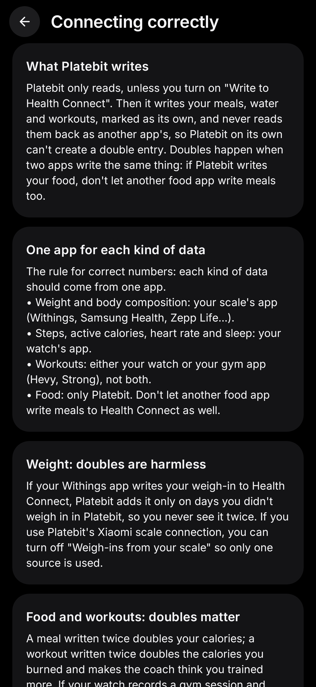
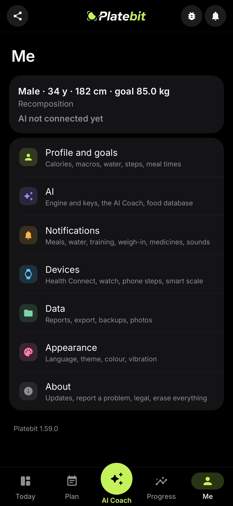

  

<h1 align="center">Platebit</h1>

  <b>Snap your meal. Know your calories. Get coached.</b> 
  A free Android calorie tracker and AI fitness coach, in Greek and English, that reads photos of your food with the AI you choose.

  

  
  
  
  

  
  
  
  

  
  
  
  

  

## Στα ελληνικά

Το Platebit είναι δωρεάν εφαρμογή Android για θερμίδες, διατροφή και προπόνηση, με AI Coach που μιλάει ελληνικά.

- Φωτογραφίζεις το πιάτο ή γράφεις «6 βραστά αυγά», και βλέπεις θερμίδες, πρωτεΐνη, υδατάνθρακες και λιπαρά.
- Πλάνο γευμάτων από τις θερμίδες και την πρωτεΐνη σου, με λίστα αγορών ανά διάδρομο.
- Πρόγραμμα προπόνησης και καταγραφή σετ με τα κιλά της προηγούμενης φοράς, και εισαγωγή από το Hevy.
- AI Coach με chat και ζωντανή φωνή (και Gemini Live), που ξέρει τα δικά σου δεδομένα.
- Υπενθυμίσεις για γεύματα, νερό, φάρμακα, προπόνηση και ζύγισμα, και εβδομαδιαία ανασκόπηση κάθε Κυριακή.
- Health Connect για ρολόι, δαχτυλίδι και ζυγαριά, widget στην αρχική οθόνη, αναφορές PDF και αυτόματο αντίγραφο ασφαλείας.
- Χωρίς λογαριασμό και χωρίς διαφημίσεις: τα δεδομένα μένουν στο κινητό σου.

**Εγκατάσταση:** κατέβασε το [Platebit.apk](https://github.com/jemangr/platebit-releases/releases/latest/download/Platebit.apk) στο κινητό, άνοιξέ το και επίτρεψε την «Εγκατάσταση άγνωστων εφαρμογών» αν το ζητήσει. Οι ενημερώσεις έρχονται μέσα από την εφαρμογή. Χρειάζεται Android 12 ή νεότερο. Τι αλλάζει σε κάθε έκδοση: [CHANGELOG.md](CHANGELOG.md) και [Releases](https://github.com/jemangr/platebit-releases/releases).

## What it does

**Track**
- 📸 **Photo to calories.** Take a picture of your plate (or a nutrition label) and get calories, protein, carbs and fat. Adjust the grams or the portion and it recalculates instantly.
- ✍️ **Or just say it.** Tap + and write "6 boiled eggs" or "a pork gyros souvlaki, no-oil pita, tomato, yogurt": the AI splits it into foods with grams for you to check.
- 📦 **Packaged food done right.** Platebit reads the package and serving size, so one tap logs 1 serving, ½ or ¼ package, the whole package or 100 g. Type label values as printed: per 100 g, per package or per serving.
- 📊 **One clean diary.** Calories, macros, water, activity and a weight trend you can swipe through day by day; add food or a weigh-in to any past day.
- 🗓️ **History.** Days, weeks and months: calories against your target, macros, water, trend weight and how many days you were on target.
- 📄 **Reports and export.** A week or month as a PDF for your dietitian, trainer or doctor, daily totals as CSV for Excel, and a full backup that is always free.
- 💾 **Automatic backup.** Every week to a folder you pick (a synced Google Drive or Nextcloud folder keeps it off the phone too), keeping the last 8. Backups hold meals, water, weight, profile, settings, medicines, workouts, meal plans and your program; never API keys or photos.

**Plan and coach**
- 🎯 **A plan built from your answers.** Setup asks your goal (lose fat, recomposition, build muscle, maintain, performance, health), training history, your day (school or work, whether you can bring food), supplements and coffee, and health notes kept only for safety. You get calories and macros, carb cycling for training days, a water goal that stops before sleep and respects a doctor's fluid limit, and meal times around your day.
- ✏️ **Your numbers win.** Prefer your own calories, macros, water or meal times? Type them in; Platebit marks them as yours and follows them.
- 🍽️ **Meal plan.** A week of meals from your calories and protein with common Greek foods, no AI needed: lock what you like, swap the rest, add your own, approve the week. Away from home without a fridge? It suggests foods for your bag.
- 🛒 **Shopping list.** The week's plan as one list by aisle: the same food across days adds up, cooked rice, pasta, legumes, meat and fish become raw or dry amounts, eggs, pitas and cans are counted. Tick items as you shop (kept until next week) or share the list as text.
- 🏋️ **Training program.** A suggested program from your days, level, gym or home and goal (sets, reps, rest and when to add weight), or type your own one exercise per line.
- 📝 **Log your workouts.** Start a workout and every set is filled in with last time's weight and reps; tick a set to start the rest timer, which keeps running in the notification with the screen off and vibrates when the rest is over. Warm-ups, drop sets, sets to failure and RPE; supersets go straight to the next exercise and rest after the round. When every set reached the top of the range it says how much to add (2.5 kg upper body, 5 kg lower), and a set that beats your best is marked PR. Saved as you go, so leaving the app mid-workout loses nothing. At the end: a summary with the records you beat, and a picture to share (Pro). Already on Hevy? Import its CSV export, set types included. The AI Coach sees the last two weeks of what you lifted.
- 🗂️ **Routines and records.** Build your own program like a gym app: exercises in order, sets, reps, rest and warm-ups for each, supersets by linking an exercise to the next, or start from the suggested one. Every exercise has its history: heaviest weight, best estimated 1RM and best session volume, a chart of your estimated 1RM over time, and every session.
- 🎙️ **Gemini Live (optional).** With a Gemini key, Live can use Gemini's own voice: it answers as you talk and you can interrupt it mid-sentence; what was said is added to the chat.
- 🤖 **AI Coach.** Tap the button in the middle of the screen to talk live, or hold it for the chat. It knows your meals, water, weigh-ins, body composition, activity, meal plan and program, answers from your own numbers and prepares changes as cards you accept or decline. It only talks about food, training, sleep, your data and the app.
- 💊 **Medication reminders.** Each medicine or supplement gets a label, dose, days and times. The notification lists them in detail with Took them / Forgot; the diary asks once per part of the day ("Morning medicines", one tap for all of them), then clears and says what's next. You decide, per medicine, whether the AI Coach may see it.
- 📱 **Home-screen widget.** Calories and protein left, water with a +250 ml button that logs without opening the app, and today's medicines with the next dose. Tap it to open the diary.
- 📊 **Weekly review.** Sunday at 20:00: the week's calories against target, days on target, protein, water, trend weight, workouts and medicines, plus one concrete thing to try next week.
- 🔔 **Reminders, each with its own switch.** Meals ("did you follow the plan?" with Yes / Didn't eat / Ate something else), water (only when you're behind, stopping before sleep), protein, training days, weigh-ins, new versions, and "new features explained": after an update, one notification a day that explains a feature in detail.

**Your devices and your AI**
- ⌚ **Health Connect.** Steps, workouts, sleep and heart rate from your watch or ring, and weigh-ins from scales such as Withings or Samsung. Platebit only reads, and its "How to connect correctly" guide shows which app writes what, so food and workouts are never counted twice; the same workout from two apps counts once.
- 🔑 **Bring your own AI.** DeepSeek, Gemini, OpenAI, Claude, OpenRouter or any OpenAI-compatible service. The step-by-step setup connects OpenRouter with one tap and walks you through a key for the others. You pay the provider directly, or use its free quota; Platebit has no servers.
- 📈 **AI use and limits.** Requests and tokens per day, week and month, with your own limits, warnings at 80% and 100% and an optional stop.
- 🇬🇷 **Greek and English.** Pick the language in Settings → Appearance → Language (or in Android's app language settings).
- 🔒 **Private by design.** No account, no ads, no tracking. Your data stays on your phone; photos and questions go only to the AI you pick, never through us.

## Install

1. [Download the APK](https://github.com/jemangr/platebit-releases/releases/latest/download/Platebit.apk) on your phone and open it. Allow "Install unknown apps" if Android asks.
2. Answer the setup questions (about 2 minutes).
3. Open **Settings → AI engine → Step-by-step setup** and connect an AI.
4. Tap the camera and scan a meal.

Updates arrive inside the app (**Settings → Updates**). Needs Android 12 or newer. Calorie, body and training figures are estimates, not medical advice. See [CHANGELOG.md](CHANGELOG.md) for what changed in each version.

## Optional: Open Food Facts

On by default (you can turn it off in **Settings → Food database**), Platebit uses it to read product barcodes (just point the camera at one) and check packaged foods against the free [Open Food Facts](https://world.openfoodfacts.org) database, search products when adding food, and log a product in a few taps with the **+** buttons. Only food names are sent, never photos.

## The AI Coach (beta)

Tap the **AI Coach** button in the middle of the Diary, Scan, Body or Settings screen to talk with it **live** (the first tap asks before turning it on): it listens, answers aloud and listens again, like a phone call, and a short "yes" or "no" answers its proposals. Hold the button, or pull down on a screen and hold until the bubble pops, for the text chat: a chat slides in that knows your meals, water, weigh-ins and body composition, so you can ask how you're doing and get advice based on your own numbers. Ask it to log a meal, water or a weigh-in, or to change a target, and it prepares the change as a card you accept or decline. Mention a brand (say, a Lacta) and it looks the product up on Open Food Facts first, so the card uses the real label values. **Talk to it:** tap the AI Coach button for a live conversation, or tap the mic in the chat, and just speak (Greek or English, set in Settings). Your phone turns your voice into text, nothing is recorded or kept, and the coach reads its answer back aloud (turn that off with the speaker button). The coach only talks about food, training, sleep, water, your data and the app. It uses the AI engine you already set up and is off by default. For now Platebit is tuned for Greece: the AI expects Greek foods and brands, and Greek products come first in searches.

## Optional: Xiaomi smart scale

New in 1.0. If you have a **Xiaomi Mi Body Composition Scale 2** (model **XMTZC05HM**), turn on **Settings → Smart scale** and Platebit reads it directly:

- ⚖️ **Hands-free weigh-ins.** Open Platebit and step on the scale barefoot: a full-screen dial follows your weight while it measures, then the weigh-in is saved by itself. It only listens while the app is open, there's nothing to pair, no Xiaomi account, and Zepp Life keeps working. A reading more than 5 kg from your last one asks "Is this you?" first.
- 🧍 **Body screen.** Tap the Weight card for a body score, BMI, and estimates of body fat, muscle, water, bone, visceral fat, BMR and body age, with trends over time. Swipe sideways to step through past measurements, and the screenshot button saves the whole page as one picture in your gallery (Pictures/Platebit), handy for comparing over time.

It's off by default, and other scale models aren't supported. Body composition is estimated from published formulas: good for following trends, not a medical measurement.

## How the plan is worked out

Onboarding asks about your goal (lose fat, recomposition, build muscle, maintain, performance, health), training history and current routine, how you record workouts, your day (wake, sleep, school or work, whether you can bring food), supplements and coffee, and health notes kept only for safety. `PlanEngine` turns the answers into calories and macros (Katch-McArdle when body fat is known, protein by goal, a fat floor), carb cycling for training days, a water goal with creatine and coffee add-ons that never passes a doctor's fluid limit, a last-drink time before sleep, meal times around your day with portable options, a training split and the best way to record workouts. The AI Coach gets all of it as context. Profiles from older versions keep their numbers until the questions are answered.

## Credits

Built on the open-source [Platebit](https://github.com/Joji228/Platebit) project (MIT License). The [Inter](https://rsms.me/inter/) font is used under the SIL Open Font License.
